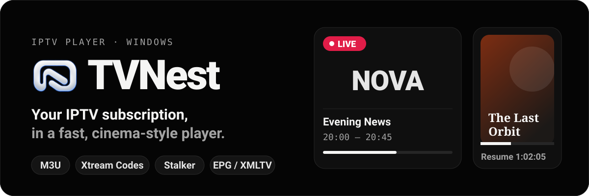
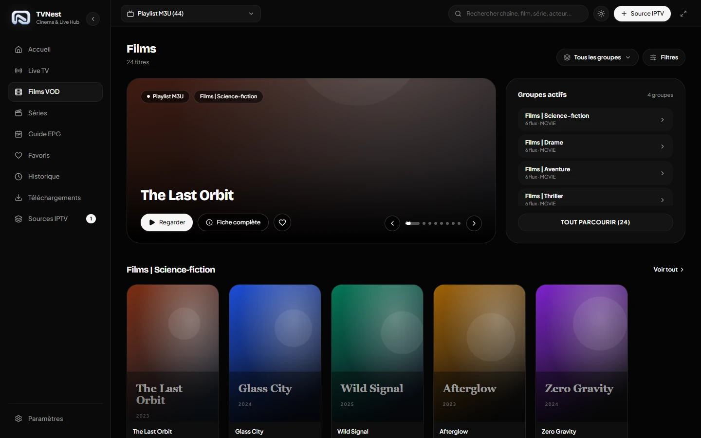
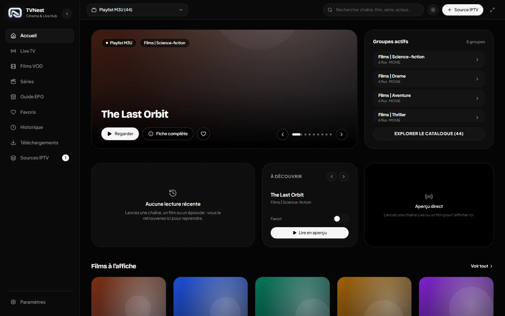
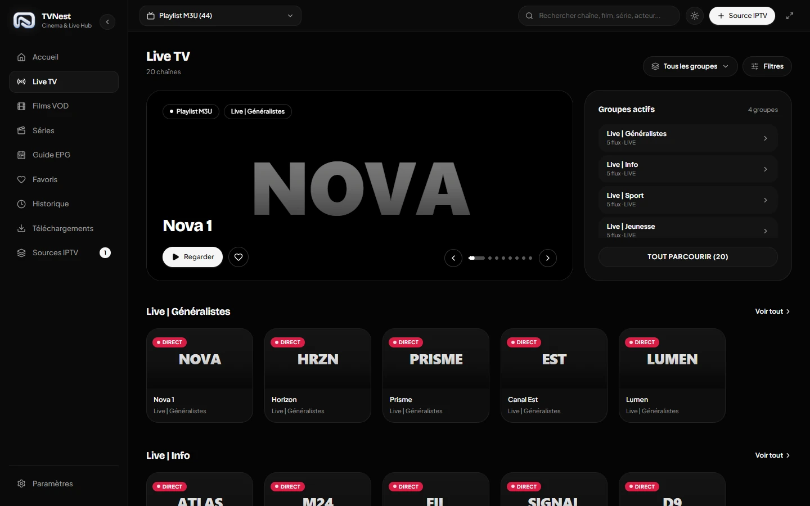
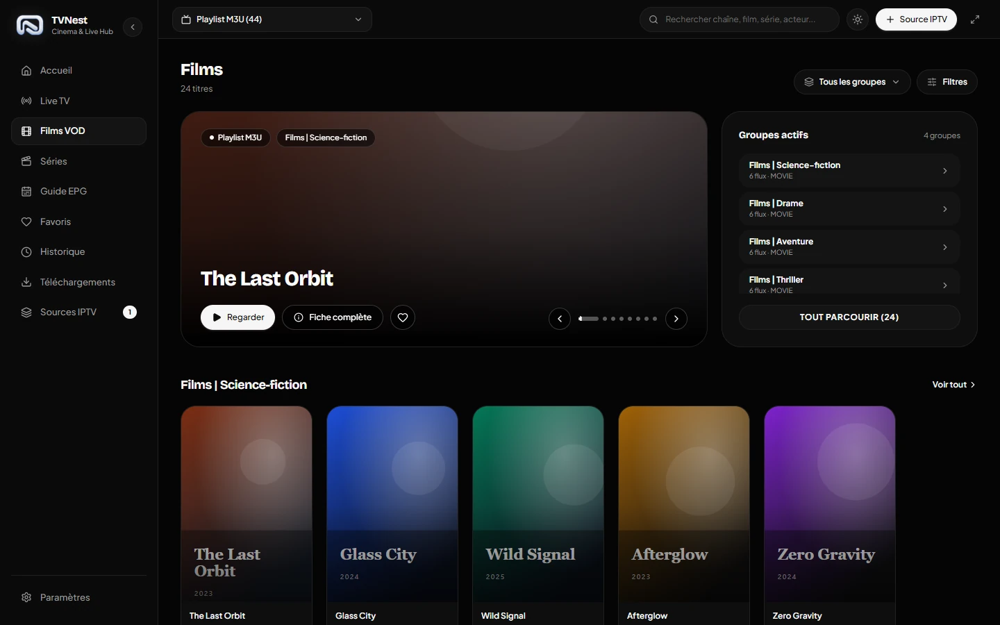
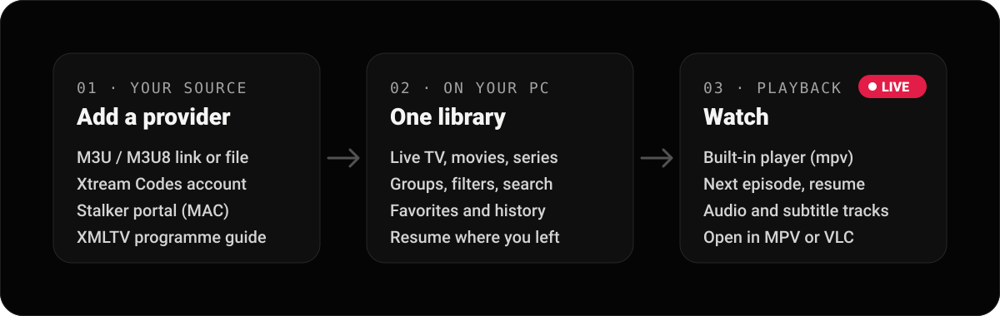

<p align="right"><b>English</b> · <a href="README.fr.md">Français</a></p>

<p align="center">
  
</p>

<p align="center">
  <a href="../../releases/latest"></a>
  
  <a href="LICENSE.md"></a>
</p>

**TVNest** turns your IPTV subscription into a desktop app that feels like a streaming service: live TV, movies and series in one dark, fast library, with a built-in player that remembers where you stopped.

> TVNest is **only a player**. It does not provide any channels, subscriptions or playlists. Bring your own.

<p align="center">
  
</p>

<table>
  <tr>
    <td width="33%"></td>
    <td width="33%"></td>
    <td width="33%"></td>
  </tr>
  <tr>
    <td align="center"><sub>Home</sub></td>
    <td align="center"><sub>Live TV</sub></td>
    <td align="center"><sub>Movie page</sub></td>
  </tr>
</table>

<sub>Screenshots use fictional sample content.</sub>

## What you get

- **All your sources in one place** — M3U / M3U8 links or files, Xtream Codes accounts, Stalker portals and XMLTV guides.
- **A library that feels like streaming** — featured titles, one row per group, quick filters (language, quality, rating, year) and a global search across sources.
- **A player built for watching** — embedded mpv with audio and subtitle tracks, speed and aspect controls, live recording, keyboard shortcuts, and MPV or VLC if you prefer.
- **Pick up where you left off** — resume or restart any movie or episode, automatic next episode, history and favorites.
- **Live TV with a guide** — what's on now and next, and a day-by-day programme grid.
- **Made for the desktop** — pure black theme, responsive layout, automatic updates.

## How it works

<p align="center">
  
</p>

Your catalog is imported into a local database on your PC, so browsing stays instant even with more than 100,000 titles. Your sources and credentials stay on your PC.

## Get started

1. Download `tvnest-<version>-windows-x64-setup.exe` from the [latest release](../../releases/latest) and install it.
2. Open TVNest and click **Source IPTV**.
3. Choose **Xtream**, **M3U URL**, **Fichier** (file), **Texte** (paste) or **Stalker**, then enter the details from your provider.
4. Browse Live TV, Movies and Series, and press play.

TVNest checks GitHub for new versions and updates itself.

**Good to know**

- Windows 10 and 11 (x64) only for now.
- The interface is in French. English and Spanish are partially translated.
- If your provider refuses the connection, TVNest tells you why (wrong credentials, expired subscription, too many connections…).

## Build from source

Requirements: Node.js (see `.nvmrc`), pnpm 10 and Visual Studio Build Tools (for the native mpv module).

```bash
pnpm install --frozen-lockfile
npm ci --prefix apps/web
pnpm run serve:frontend   # React interface (Vite) on http://localhost:4200
pnpm run serve:backend    # Electron app
```

Build the Windows installer locally:

```bash
pnpm run make:app -- --publishPolicy=never
```

The installer is written to `dist/executables/`.

<details>
<summary>Continuous integration</summary>

The [`build-windows.yml`](.github/workflows/build-windows.yml) workflow runs on a self-hosted Windows x64 runner:

- push to `master` or manual run: the installer is copied on the runner machine, into the `TVNEST_INSTALLERS_DIR` folder set in the runner's `.env` file;
- `v*` tag: the installer is published in a GitHub Release, which the automatic updater uses.

</details>

## Credits and license

TVNest is made by **Steven K.** It is based on [IPTVnator](https://github.com/4gray/iptvnator) by 4gray (MIT license): the original Electron backend, database and mpv player are kept, and the interface has been rebuilt in React.

[MIT](LICENSE.md). The name and logo "IPTVnator" belong to their author and are not used as this project's identity (see [TRADEMARK.md](TRADEMARK.md)).
